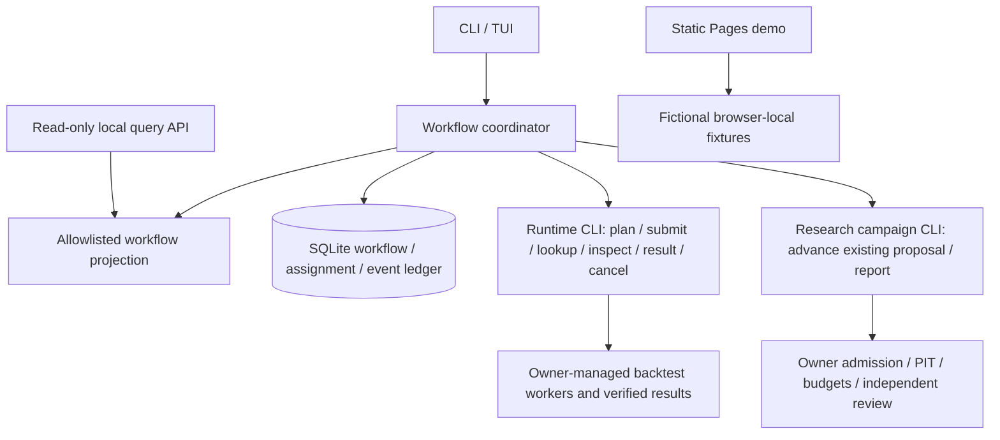

# Architecture

One workflow connects existing owners without taking over their authoritative
state. The initial release adds observation and bounded reconciliation, not a
replacement research agent runtime.

The coordinator persists dispatch intent before an external effect. A crash or
lost response switches recovery to original-key lookup. It does not infer success
from files, worker exit, an event or a model's text. DAG dependencies require a
successful adapter outcome. Result integrity and economic evidence remain separate.

The Research adapter can reconcile an existing native Agent campaign, including
one paused between sessions. It does not launch Codex/Hermes/DSH, choose a model,
admit experiments, create conclusions or request promotion. Those require explicit
owner tools and their budgets. `COMPLETED_UNVERIFIED` stays blocked here until an
owner records its evidence decision. `DISCARDED` means the owner's process completed;
it is never relabeled as a positive investment result.

## References and implementation choices

[QuantStudio](https://github.com/quantskills/QuantStudio) motivates discoverable
capabilities and a coherent view of work and artifacts.
[DeepSeek's Super-agent prototype](https://github.com/deepseek-ai/dsh-superagent-prototype)
motivates separating durable work items, execution assignments and event hints.
These are architectural references. No source code from either repository was copied.
The current coordinator uses deterministic routing to registered owners; it does
not implement an LLM Router, mailbox team runtime or autonomous agent delegation.

## UI delivery

The live terminal UI consumes `quant.workflow_view.v1`, also returned by the
loopback API. The Pages demo illustrates a future browser workbench, including
data/PIT/review stages beyond the two executable adapter kinds in v0.1. Its
fictional Skill revision labels are not installable catalog entries. It never
connects to the loopback API, loads owner configuration or publishes private state.
A live authenticated GUI can reuse the projection in a subsequent release.

## Scope boundaries

No matching, strategy construction, raw data ownership, production cron migration,
live trading or distributed leases. The service runs trusted owner CLIs under the
operator's identity. It is not a sandbox. Separate OS identities or isolation must
be provided by deployment when required. No production service is installed here.
