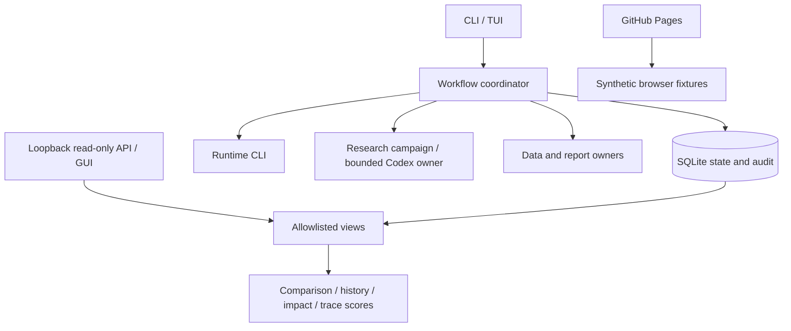

# Architecture

[简体中文](architecture.zh-CN.md)

The coordinator records cross-owner workflow state and explicit approval. Runtime
owns workers and result publication. Research owns admission, research decisions,
independent review and promotion. Data and report owners retain their contracts.

The coordinator persists intent before dispatch. Lost responses reconcile the
original owner identity rather than blindly resubmitting. Computation success,
input integrity, historical PIT, execution semantics and research conclusions are
separate evidence dimensions. Promotion remains unknown here.

Bounded Codex lifecycle and tool-profile enforcement live in the Research Owner.
V1 is tool-free; v2 explicitly binds four read-only MCP tools and their files.
The coordinator can also observe completed pinned receipts without invoking a
model. Campaign reconciliation operates only on existing approved proposals.
No LLM router, mailbox team runtime or autonomous delegation is introduced.

Evidence can carry owner scope and assessment validity. Requested data, strategy,
universe, historical as-of and sample coverage must match before a scoped
successor starts. Assessment freshness uses wall time, separately from market
time. Expiry blocks new admission; it does not rewrite completed research history.
Legacy unscoped workflows remain readable and do not gain scoped certification.

History snapshots and evaluation reports are additive, replaceable projections.
Research history is imported only from explicit digest-pinned owner exports;
operational failure is not negative economic evidence. Comparisons expose
engineering identities and observed use, not unexported financial metrics or
causal conclusions. Impact preview reads one consistent SQLite snapshot and
executes nothing. Reference trace scores test a fixed harness, never model quality.

The GUI, TUI and API share safe projections. The API binds loopback, optionally
requires a private bearer token and rejects HTTP writes. Queries never invoke
owners. English/Chinese UI catalogs separate human labels from stable contracts.
GitHub Pages remains synthetic; the installed offline demo uses a public protocol
peer and external data directory, with no private package or model dependency.

The implementation is single-machine, one scheduler per database. It supervises
trusted owner CLIs; it is not an operating-system sandbox. Real deployments must
provide suitable process identities and isolation. Restore, local notification
reconciliation and migration preflight do not switch production schedules or send
external messages. A separately installed private read-only workbench is not
production scheduler adoption.

QuantStudio and DeepSeek Super-agent informed capability discovery and durable
work-item separation. Their source code is not copied into this repository.
See [owner adapters](owner-adapters.md), [evidence](evidence-applicability.md),
[insights](insights.md) and [research integration](research-closure.md).
